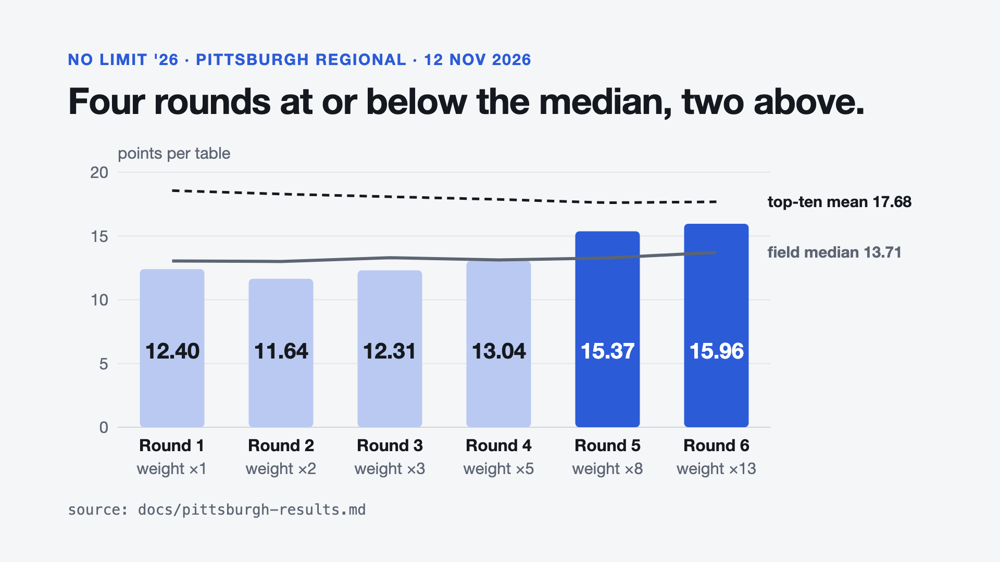
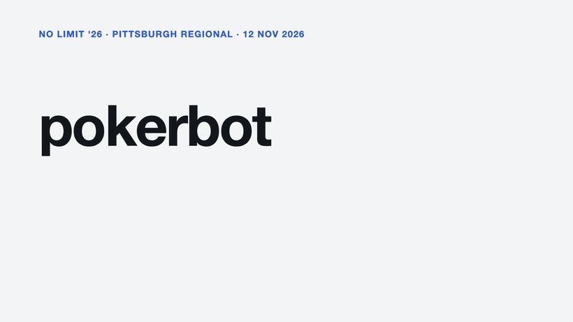
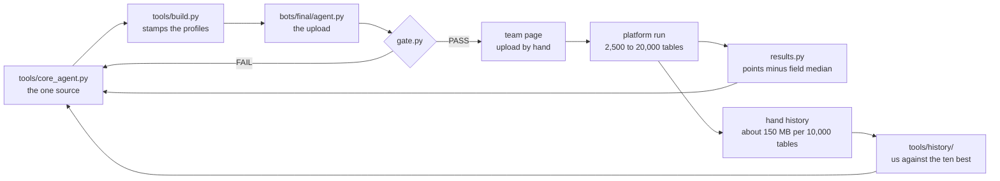
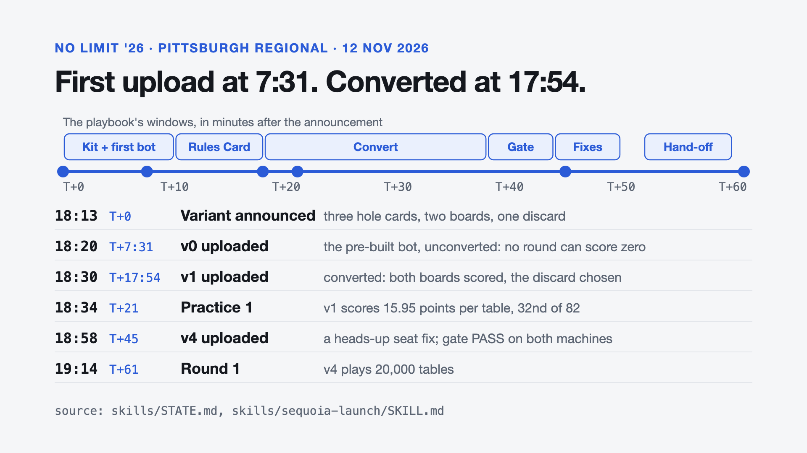
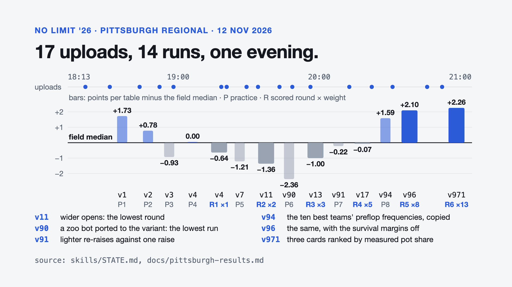
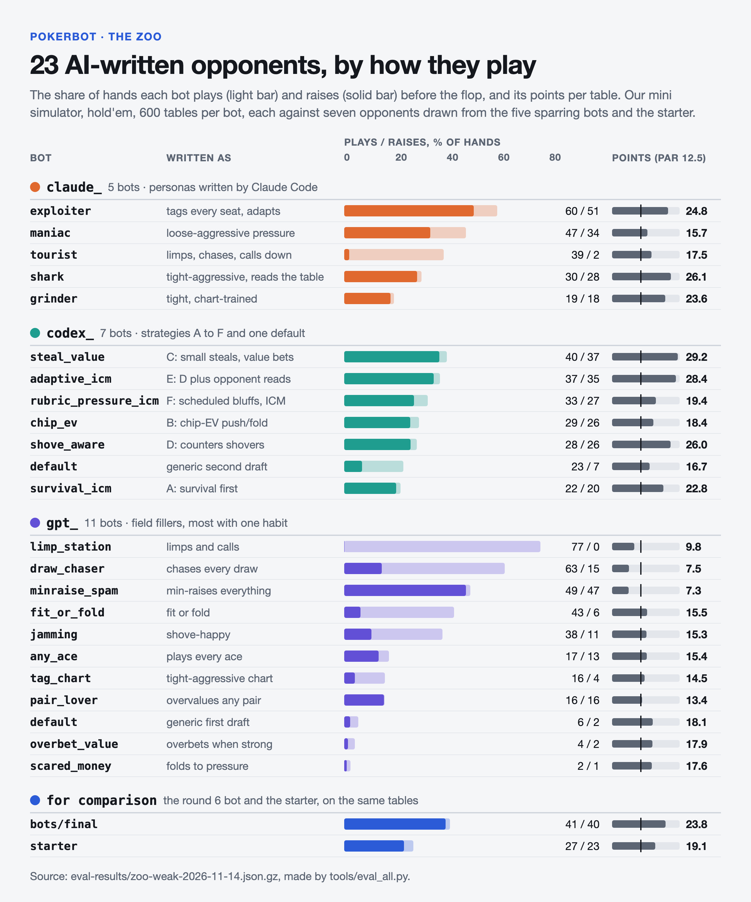

<h1 align="center">pokerbot</h1>

<p align="center">
  <em>A one-file poker bot for Sequoia's NO LIMIT '26, and the record of the regional it played.</em>
</p>

<p align="center">
  
  
  
  
  
</p>

<p align="center">
  <b><a href="docs/pittsburgh-results.md">Results</a></b> ·
  <b><a href="media/build.mp4">Build video</a></b> ·
  <b><a href="media/results.mp4">Results video</a></b> ·
  <b><a href="skills/STATE.md">Event log</a></b>
</p>

---

**pokerbot** is Team Allow It's entry for [NO LIMIT '26](https://pokerbot.sequoiacap.com/), Sequoia's poker bot tournament, and the tools that built and judged it. The bot is one Python file, [`bots/final/agent.py`](bots/final/agent.py), that answers every decision in under **1 ms** with the standard library only. At the Pittsburgh regional on 2026-11-12 the variant was announced at 18:13 (**three hole cards, two boards, one discard after the turn**), the first converted bot was uploaded 18 minutes later, and after six scored rounds the team finished **37th of 112 scoring teams with 468.31 points**. The first three rounds scored below the field median, the fourth at it, and the last two above it; what changed between them is the most useful thing in this repo.

The event is over, the team is not playing the finals, and the bot is frozen at the file that played round 6.

<p align="center">
  
</p>

The key features are:

- **One file that did not fail**: `act` wraps the whole strategy, turns any exception into a check or a fold, and clamps every raise to the legal range. 80,989 bytes, no missed decision and no restart in 14 platform runs.
- **A variant table**: `VARIANTS` in [`tools/core_agent.py`](tools/core_agent.py) has one entry per ruleset (seven), each saying how to recognise the game, how to answer its extra phases and how to score the cards. The betting strategy is written once and reads only 0 to 1 scores.
- **Two-board scoring**: `double_board_strength` scores a pair on each board and averages, since each board wins half of every pot; `double_board_keep` keeps the pair with the most strength summed over both boards, and the discard throws away the third card.
- **Preflop copied from the leaders**: `_cloned()` holds the measured first-in, all-in-call and re-raise frequencies of round 3's ten best teams (round 1's in `v94`), by players left, seats behind and stack depth, and uses them as percentile thresholds.
- **A measured three-card ranking**: `pittsburgh_preflop` ranks three cards by their dealt pot share, by hand class. The earlier "best two cards" ranking overrated pairs by 8 to 12 points of equity and weak aces by 10; the fit is within 0.013 of the dealt share on eight test hands ([`tools/preflop_check.py`](tools/preflop_check.py)).
- **One safety gate**: [`gate.py`](skills/sequoia-launch/scripts/gate.py) prints `GATE: PASS` or `GATE: FAIL` from a build check, 20,000 fuzzed states, hidden-exception and memory checks, decision timing and real tables. The round 6 bot passes it on the organizers' engine and on the mini simulator.

## Results

Each scored round played 20,000 tables of eight bots; a table pays 50, 30 and 20 points to the first three places, so par is 12.5 points per table. The margin is the portal's, about two standard errors. Rounds weigh 1, 2, 3, 5, 8 and 13.

| Round | Weight | Bot | Points per table | Rank in the round | Field median | Us minus median | Tables won |
| --- | --- | --- | --- | --- | --- | --- | --- |
| 1 | 1 | `v4` | 12.40 ± 0.23 | 67 of 109 | 13.04 | -0.64 | 9.2% |
| 2 | 2 | `v11` | 11.64 ± 0.23 | 72 of 111 | 13.00 | -1.36 | 9.2% |
| 3 | 3 | `v13` | 12.31 ± 0.22 | 68 of 112 | 13.30 | -1.00 | 7.8% |
| 4 | 5 | `v17` | 13.04 ± 0.24 | 59 of 112 | 13.12 | -0.07 | 11.2% |
| 5 | 8 | `v96` | 15.37 ± 0.28 | 21 of 112 | 13.28 | +2.10 | 20.0% |
| 6 | 13 | `v971` | 15.96 ± 0.28 | 21 of 112 | 13.71 | +2.26 | 19.5% |

Final standing: 37th of 112 scoring teams (146 entries, 34 forfeited), 468.31 points; first place had 598.3 and tenth 542.3. Every run including the eight practice runs, the standing after each round and the comparison with each round's ten best teams are in [`docs/pittsburgh-results.md`](docs/pittsburgh-results.md); the reader outputs behind it are in [`docs/pittsburgh-results/`](docs/pittsburgh-results/), and the step-by-step log of the night is [`skills/STATE.md`](skills/STATE.md). Vedaant's analysis from the night, run by run, is in [`docs/research_notes/pittsburgh/`](docs/research_notes/pittsburgh/README.md).

<p align="center">
  <a href="media/results.mp4">
    
  </a>
  <br>
  <sub>The 34-second results video, playing as a GIF: charts only, drawn from the numbers in <code>docs/pittsburgh-results.md</code>. Chips are counted over hands dealt with four or more players left. Click for the MP4 (1920x1080).</sub>
</p>

What the numbers do and do not show:

- **Four weak rounds.** In rounds 1 to 4 the bot lost chips in hands dealt with four or more players left (-0.4 to -5.0 big blinds per 100 hands against the ten best teams' +12 to +14) and won 34 to 49% of its heads-up matches against their 61 to 67%.
- **Two strong rounds, from one method.** From round 5 the bot played the ten best teams' measured preflop frequencies with its survival margins turned off. Play with four or more left went to +9.4 and then +13.7 big blinds per 100 hands, and the share of tables won went from 8 to 11% to about 20%.
- **Round 6 did not beat round 5.** `v971` added the three-card ranking and smaller opens. Against the median it was +2.26 after +2.10, inside the margins of ± 0.28 each.
- **The local test was wrong all night.** The kit gauntlet (our bot against the starter, five sparring bots and 23 AI-written zoo bots) scored the round 1 bot at 28.08 ± 0.25 points per table. The field scored it 12.40. The gauntlet's opponents reach showdown in 20 to 90% of hands and real teams in 8 to 13%. It read `v94` against `v13` as -0.27 ± 0.32; on the platform `v94` scored 14.90 in practice 8 (+1.59 against the median) where `v13` had scored 12.31 in round 3 (-1.00).
- **Still open.** In round 6, 43% of our opens were re-raised and we folded 65% of those; the ten best teams folded 50%, and their opens earned 1.22 big blinds against our 0.94.

## How it works



1. **Core.** All strategy lives in `tools/core_agent.py`: a crash-proof `act`, the `VARIANTS` table, the betting strategy, and the embedded equity tables. The 13 float knobs of the `final` profile are in `SETTINGS`.
2. **Build.** `tools/build.py` stamps one copy per profile into `bots/<profile>/agent.py`. `--check` fails if a stamped file has drifted from the core.
3. **Gate.** `gate.py` runs every safety check and prints one verdict. Its timing counts only on the team's build machine, where the round 6 bot measured p99 185 µs against the 1,000 µs limit (80 µs on the Mac).
4. **Upload.** A person uploads the file on the team page. Nothing in this repo uploads or switches the active bot.
5. **Run.** The platform snapshots the active bot at the start of each practice run and each scored round.
6. **Read.** `results.py` prints our points, rank and the field median for a finished run. The seven readers in `tools/history/` stream that run's hand history and compare us with its ten best teams, situation by situation.
7. **Change.** The largest measured gap becomes one change in the core, and the loop starts again.

The limits that shape all of it: 1 ms per decision with a 100 ms bank per table, 64 KB of memory that is emptied at every table, anonymous seats, a 60-minute build after the variant is announced, and 20 minutes between round snapshots. Round 6 alone was 13 of the 32 weight units.

## How it was built

<p align="center">
  <a href="media/build.mp4">
    
  </a>
  <br>
  <sub>The 47-second build video, playing as a GIF: the first hour, the zoo and the loop between rounds. Drawn from <code>skills/STATE.md</code>, <code>docs/pittsburgh-results.md</code> and <code>eval-results/</code>; the deal in the card scene is an example, not a hand from the event. Click for the MP4 (1920x1080).</sub>
</p>

### The first hour

<p align="center">
  
  <br>
  <sub>The playbook's windows (<code>skills/sequoia-launch/SKILL.md</code>) and what happened (<code>skills/STATE.md</code>).</sub>
</p>

The variant is secret until the build starts, and a team with no active bot at a round's snapshot scores zero for it. [`skills/sequoia-launch`](skills/sequoia-launch/SKILL.md) is the playbook for that hour: a clock with upload cutoffs, a Rules Card read from the kit, and one gate. On the night:

1. **18:13, T+0.** The variant is announced: three hole cards, two boards, one discard after the turn.
2. **18:20:31, T+7:31.** `v0` is uploaded: the pre-built `final` bot, unconverted. It scores board 1 only and lets the platform discard its lowest card, but it is legal, so no round can score zero.
3. **18:30:54, T+17:54.** `v1` is uploaded, 20 minutes before the playbook's gate window opens: the same bot with a `double_board_turn_discard` entry in `VARIANTS` (both boards scored, the discard chosen). The gate passed on both machines (p99 193 µs on the build machine against the 250 µs we allow), and the portal showed it ready and active 56 seconds after the upload.
4. **18:34, T+21.** Practice 1: `v1` scores 15.95 ± 0.68 points per table, 32nd of 82.
5. **18:58, T+45.** `v4`: `v1` plus a heads-up big-blind seat fix, gated again on both machines.
6. **19:14, T+61.** Round 1 takes its snapshot with `v4` active.

The clock and the gate held. What the hour did not produce was a way to tell a good bot from a bad one: `v1` was +1.73 over the median in practice 1 with 82 teams playing, and `v4` was +0.00 in practice 4 and -0.64 in round 1.

### Between rounds

<p align="center">
  
  <br>
  <sub>Every platform run of the night against that run's field median, with the bot that played it. Wide bars are scored rounds with their weights. Source: <code>docs/pittsburgh-results.md</code>, "Every run"; upload times from <code>skills/STATE.md</code>.</sub>
</p>

Rounds started 20 minutes apart, with a practice run about halfway between, except before round 6. From the announcement to round 6's snapshot the team uploaded 17 times (16 distinct files) and the bot played 14 platform runs: eight practice runs and six scored rounds. The loop that produced rounds 5 and 6 is the one drawn in [How it works](#how-it-works), written down as [`skills/mid-round-iterate`](skills/mid-round-iterate/SKILL.md) and rewritten after the event around what worked. Each row below is one turn of it.

| Version | What the hand histories showed | Change | Platform result |
| --- | --- | --- | --- |
| `v91` | Every calling line lost chips; the ten best teams re-raised 4.2% of hands, we 1.1% | Re-raise a single raise with the top 15% / 12% / 6% of hands (big blind, small blind, other seats) | Practice 7: 12.78, -0.22 against the median (`v13` in round 3: -1.00) |
| `v94` | The gap to the leaders was first places (9% against 26%); heads-up we won 38%, they 65% | `_cloned()`: the ten best teams' preflop frequencies by players left, seats behind and stack depth | Practice 8: 14.90, +1.59 |
| `v96` | Survival margins steered us to 2nd to 4th place | `icm_scale`, `points_tight` and `bubble_margin` to 0, with round 3's tables | Round 5: 15.37, +2.10 |
| `v971` | Ranking three cards by their best two overrated pairs by 8 to 12 points of equity | The measured three-card ranking, 2.3 bb opens | Round 6: 15.96, +2.26, inside the margins of `v96` |

What did not move the score: wider opens (`v11`, round 2, 11.64, the lowest round), a port of the zoo's exploiter (`v90`, practice 6, 11.02, the lowest run), and heads-up tweaks one at a time (`v7`, practice 5, -1.21).

### The zoo

<p align="center">
  
  <br>
  <sub>Each zoo bot over 600 hold'em tables on the mini simulator, each table against seven opponents drawn from the five sparring bots and the starter, on 2026-11-14. These are mini-simulator numbers, not kit or platform numbers. Data: <code>eval-results/zoo-weak-2026-11-14.json.gz</code>, from <code>python3.12 tools/eval_all.py run weak 600 --seed zoo1 --variants holdem --out eval-results/zoo-weak-2026-11-14.json.gz</code>.</sub>
</p>

[`zoo/`](zoo/README.md) holds 23 opponents written by AI assistants before the event, so the bot had a field to practise against that was not itself. Five `claude_*` bots are personas written by Claude Code (a tourist that limps, a maniac, a grinder, a shark, a seat-by-seat exploiter). Seven `codex_*` bots are strategies: A to E implemented by Codex from one strategy chat, F designed by Vedaant and implemented by Claude, and one default-style filler. Eleven `gpt_*` bots are field fillers, most built around one habit: plays every ace, min-raises everything, folds to pressure. The prefixes are folder names, not authors: the `gpt_*` bots and `codex_default_1` were written overnight in Cursor, imitating ChatGPT's and Codex's default answers. Each is one standalone `agent.py` under the competition's rules, plays the pre-event rulesets named on its `Variants:` header line (see [`zoo/variants/`](zoo/variants/README.md)), and is checked by `tools/check_zoo.py`. None has an entry for the Pittsburgh variant: there it takes the automatic choice in the discard phase. In the run above none of the 23 failed a decision in 13,800 tables.

The spread of styles is real: from 2% of hands played to 77%, and from raising 0.1% of hands to raising almost every hand played. What the zoo could not do was stand in for the field, which is why the kit gauntlet misread it (see [Results](#results)). On the hold'em tables above five zoo bots outscore the round 6 bot (23.8), and the order means little: the one zoo bot that reached the platform, ported as `v90`, had our lowest run. Use the zoo to find crashes and timing problems at a full table, not to judge strength.

## Roadmap

| Component | Status |
| --- | --- |
| Round 6 bot (`bots/final`, byte-identical to the upload) | ✅ frozen |
| Safety gate, fuzzers, build check | ✅ |
| Results reader and hand-history readers | ✅ |
| Launch and between-rounds skills, rewritten after the event | ✅ |
| Defence when our open is re-raised (the gap still open after round 6) | ⏸️ deferred |
| Made-hand strengths measured on two boards (they are hold'em's, averaged) | ⏸️ deferred |
| Mini-simulator class for the Pittsburgh variant | ⏸️ deferred: `--mini` plays hold'em |
| Finals, 2026-11-15 | ⏸️ not playing |

## Project structure

```
pokerbot/
├── bots/           # seven stamped profiles; final/agent.py is the bot that played round 6
├── tools/          # core_agent.py (the source), build, fuzz, preflop check, evaluation tools
│   └── history/    # seven streaming readers for the platform's hand histories
├── skills/         # launch, build and between-rounds playbooks; STATE.md, the event log
├── docs/           # pittsburgh-results.md and its raw outputs; research notes, the pre-event ones dated
├── media/          # figures, the 47-second build video and the 34-second results video (MP4 and GIF)
├── starter/        # the original starter bot, kept as a baseline
├── sparring/       # five hand-written opponents
├── zoo/            # 23 AI-written opponents, a bot template, one ruleset file per variant
├── devtest/        # unofficial mini simulator and a stand-in for the organizers' SDK
├── ui/             # local practice page (plain HTML, CSS and JS, served by ui/server.py)
├── eval-results/   # mini-simulator rankings: the pre-event ones, and the zoo's styles from 2026-11-14
├── rehearsal/      # a sealed practice variant for a timed conversion
├── practice.py     # upload check and five line-ups for one bot
└── CLAUDE.md       # instructions for Claude Code sessions in this repo
```

## Requirements

Python 3.12. No packages: the repo has no dependency file because there is nothing to install. The organizers' starter kit is optional and is not in the repo (see [Data](#data)).

## Installation

```bash
git clone https://github.com/unio207/pokerbot.git
cd pokerbot
python3.12 tools/build.py --check
```

The three skills are used from Claude Code and need linking once per clone:

```bash
mkdir -p .claude/skills && for s in sequoia-launch competition-build mid-round-iterate; do ln -sfn ../../skills/$s .claude/skills/$s; done
```

## Data

Not in the repo, and why:

1. **The hand histories.** 1.7 GB for the six rounds and four practice runs, one gzip file per run. A round's file holds its first 10,000 tables: 149 to 166 MB and 1.4 to 1.6 million hands. They are in `hand-history/` on one laptop and in a private Drive folder. They name the other teams.
2. **The organizers' starter kit** (the real engine, `poker-agent`). It unlocks with a team account at the variant announcement. Every script finds it at `./starter-kit`, `../starter-kit` or `~/work/starter-kit` and falls back to the mini simulator without it.
3. **The competition API key**, read from `~/.config/no-limit-2026/api-key` by `portal.py` and `results.py`. Without it those two scripts exit with a message; nothing else needs it.
4. **Candidate bots** `v0/` to `v971/` (36 folders) and `rules_card.json`, written during the event and ignored by git. The 16 distinct files that were uploaded are on branch `uploads`, one folder each. There were 17 uploads: the round 6 file went up twice, is kept as `v971_2f1d6444` and played as submission `eb6caf1a`.

```
hand-history/                  # ignored by git
├── round1/ round5/            # round 1: a partial download and the full retry; round 5: one file; round2/: a partial
├── practice4/ practice6/
├── drive/                     # rounds 2, 4 and 6
└── hands-*.jsonl.gz           # round 3, practice 7 and 8, and round 1's .part and .truncated leftovers
../starter-kit/                # the organizers' kit, beside the repo
```

## Usage

| Step | Entry point |
| --- | --- |
| Check the stamped bots match the core | `python3.12 tools/build.py --check` |
| Safety gate, no kit needed | `python3.12 skills/sequoia-launch/scripts/gate.py bots/final --mini` |
| Safety gate on the real engine | `../starter-kit/.venv/bin/python skills/sequoia-launch/scripts/gate.py bots/final` |
| Random and malformed states | `python3.12 tools/fuzz.py bots/final --states 20000` |
| Five line-ups on the mini simulator | `python3.12 practice.py bots/final --mini` |
| Check the three-card ranking against dealt hands | `python3.12 tools/preflop_check.py` |
| Every run's result against the field (needs the key) | `python3.12 skills/sequoia-launch/scripts/results.py` |
| Read a hand history (team names from `results.py <id>`; without them `chipflow.py` uses one round's ten names, built in) | `python3.12 -I tools/history/chipflow.py <file.jsonl.gz> "<team>" ...` |
| Practice page | `python3.12 ui/server.py`, then http://127.0.0.1:8765/ |

From a clean copy with no kit, on 2026-11-13:

```console
$ python3.12 tools/build.py --check
ok
$ python3.12 skills/sequoia-launch/scripts/gate.py bots/final --mini
[WARN] rules card: not filled: limits are the pre-announcement defaults
[PASS] build check: bots/ match tools/core_agent.py
[PASS] agent.py size: 80989 bytes (limit 1048576)
[PASS] fuzz legality: 20000 states, 0 bad
[PASS] fuzz hidden exceptions: 0 raised inside the bot on 10000 clean states; check/fold share on clean states 79%
[PASS] memory growth: largest blob 96 bytes over a 250-hand busy table (allowed 16384 = 25% of 65536)
[PASS] mini tables: 300 tables over 3 line-ups, 0 failed decisions of 27971
[PASS] upload test imitation: no time bank, heads-up, 20 hands x 300: 0 of 3000 failed (0.00%; ours allowed 1%, platform rejects over 10%)
warnings: rules card
GATE: PASS
$ python3.12 tools/preflop_check.py
hand        measured  best two     fit  fit - measured   n = 12,000 deals per hand
9h 9d 2c       0.603     0.721   0.605          +0.002
Ah Kd Qs       0.603     0.651   0.604          +0.001
Ah 7c 2d       0.489     0.588   0.491          +0.002
largest gap between the fit and the measured share: 0.013
```

The gate output is cut to eight of its thirteen check lines and the preflop check to three of its eight hands. The warning is real: a clean copy has no Rules Card (`rules_card.json` is written from the kit), so the gate uses the template's limits. `--mini` plays hold'em on our own simulator, which has no class for the Pittsburgh variant: it finds crashes and illegal actions, the variant's phases are exercised by the fuzz only, and its scores say nothing about the platform. With the kit the same gate plays the real two-board game (90 tables, 0 failed decisions on 2026-11-13).

### Useful scripts

```bash
python3.12 skills/sequoia-launch/scripts/portal.py         # read-only: variant, uploads, health, runs
python3.12 skills/sequoia-launch/scripts/results.py <id>   # one run, and its ten best teams' names
python3.12 -I tools/history/run_stats.py <file>            # our places and heads-up actions
python3.12 -I tools/history/opens.py <file> "<team>" ...   # what happens after a first-in open
python3.12 -I tools/history/headsup.py <file> "<team>" ... # how often heads-up is reached and won
python3.12 -I tools/history/freq2.py <file> "<team>" ...   # their preflop frequencies as Python literals
```

## Architecture

<details>
<summary><b>The core: <code>tools/core_agent.py</code> (1,566 lines)</b></summary>

Four parts, in file order. `act(state, memory)` is the crash-proof wrapper: it never changes between variants. `VARIANTS` has seven entries (`double_board_turn_discard`, `irish`, `discard_reveal`, `omaha`, `auction`, `short_deck`, `holdem`), each with `detect`, `phases`, `strength`, `preflop` and `postflop`. `decide()` is the betting strategy with the seven `PROFILES`. The helpers hold legal actions, hand evaluation and the embedded equity tables. Nothing is random: the same state and memory give the same action. Memory is a packed byte record (a `T2` header and per-seat counters) of how each seat has played, 96 bytes at its largest in the gate's 250-hand table.

</details>

<details>
<summary><b>The Pittsburgh entry</b></summary>

Detected by `"boards" in state.variant`, so it does not depend on the name the platform sends. After the flop: `double_board_strength`, the hold'em strength of a pair on each board, averaged. With three cards: `double_board_keep`, the pair with the most strength summed over both boards; `pittsburgh_discard` returns the index of the third card. One-board lock rule: bet two pair or better on one board, never fold trips or better on one board at a price up to 0.42. Before the flop: `pittsburgh_preflop`, a by-class fit of the three cards' pot share, and `_cloned()`. `_hand_rank` and `_draws_of` (behind `hand_rank` and `_draws`) are memoised with 64 entries; 4,096 made the garbage collector pause for 1 to 2 ms.

</details>

<details>
<summary><b>The <code>final</code> knobs as played in round 6</b></summary>

`SETTINGS`, applied last: `open_size` 2.3, `steal_widen` 1.15, `steal_any` 0.85, `call_margin` 0.05, `bubble_margin` 0.0, `semi_bluff` 0.3, `cbet_air` 0.6, `hu_open` 0.65, `push_scale` 0.9, `threebet` 0.03, `call_raise` 0.08, `points_tight` 0.0, `icm_scale` 0.0. From the profile: per-seat tracking with the steal, shover, station and min-raise reads, `value_bet` 0.70, `medium_bet` 0.52. The file's header still says "full ICM pricing" and `PROFILES["final"]` still lists the pre-event values of four knobs; `SETTINGS` overrides them. They are left alone on purpose (see Background).

</details>

<details>
<summary><b>The gate</b></summary>

`gate.py` reads every limit from a Rules Card (`rules_card.json`, written by `probe.py` from the kit; the template's defaults without it). Checks: the runner's own `check`, `tools/build.py --check`, file and upload size, import time, fuzz legality on states built from the card's phases, exceptions hidden by the bot's own `try`, `tools/fuzz.py`, decision time (p99 allowed 250 µs, p99.9 500 µs, both our margins under the 1,000 µs limit), memory growth, tables with zero failed decisions, and on the mini simulator an imitation of the upload test with no time bank.

</details>

<details>
<summary><b>The skills</b></summary>

`skills/sequoia-launch` takes the team from the variant announcement to a converted, gated, active bot on a clock; `skills/competition-build` is its short form; `skills/mid-round-iterate` is the loop between rounds. The last one was rewritten after the event: it now promotes a version on its points minus the field median in a practice run, not on the kit gauntlet.

</details>

## Background

The plan before the event was an ICM-aware bot that never fails, tuned against a zoo of AI-written opponents, with every change promoted on a same-seed gauntlet. The never-fails part held: no missed decision in 14 runs. The rest did not. The ICM bot scored below the median in rounds 1 to 3 (-0.64 to -1.36), and the gauntlet could not tell a good preflop change from a bad one. The notes written before the event are still in `docs/`, each with a dated line at the top saying what turned out differently.

Three decisions worth knowing:

- **Versions are compared on points minus the field median, not on points.** The field kept improving: the median was 13.28 in round 5 and 13.71 in round 6.
- **Copy measured frequencies before trying ideas.** Every change that moved the platform score copied something the ten best teams were measured doing. Raising aggression past their rates (1.25 to 1.5 times) lost head to head.
- **The core is frozen.** `bots/final/agent.py` is a byte copy of `tools/core_agent.py`, so fixing even a stale comment would make the repo's bot differ from the one that played. The stale lines are listed in [`CLAUDE.md`](CLAUDE.md) instead.

## Research question

> With one hour to build and twenty minutes between rounds, what should judge a change to a bot: a local gauntlet against bots we wrote, or the field itself?

At this event, the field: its results arrived within seconds of a run finishing, and its hand histories said what to change.

## Author

Henry Zou and Vedaant, Team Allow It. NO LIMIT '26, Pittsburgh regional, 2026-11-12.
