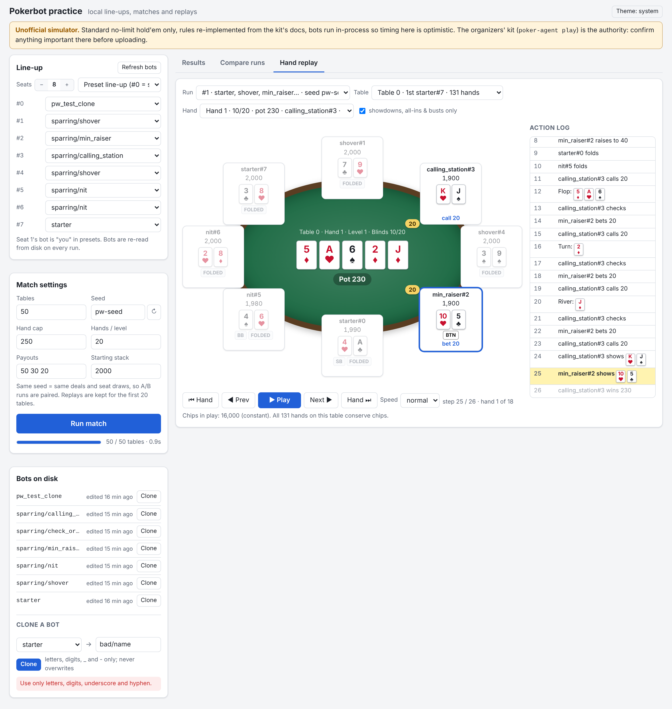

# Pokerbot practice setup (No Limit, Pittsburgh)

A starter bot, five sparring opponents, and a practice runner. The bot is written against
the interface in the organizers' starter kit (`poker_agent_sdk`: `act(state, memory) ->
(Action, bytes)`), so `starter/agent.py` is uploadable as is.

## What is here

| Path | What it is |
| --- | --- |
| `starter/agent.py` | The starter bot. One file, standard library only. |
| `sparring/*/agent.py` | Opponents: `check_or_fold`, `min_raiser`, `calling_station`, `shover`, `nit`. |
| `practice.py` | Upload check, then five line-ups, reporting points per table and failed decisions. |
| `tools/gen_preflop.py` | Regenerates the preflop equity table embedded in a bot. |
| `ui/` | Local web page for building line-ups, running matches, comparing runs and replaying hands. Uses the organizers' kit when it is installed. |
| `zoo/` | Opponent bots to tune against, with a template and instructions for adding one (`zoo/README.md`). |
| `docs/` | Competition research, baseline strategies, edge plan, bot-zoo guide and a strategy research prompt. |
| `devtest/` | Unofficial mini simulator and SDK stand-in, for when the kit is not installed. |

## Practising under the real rules

The authority is the organizers' starter kit. According to the competition's Getting
started page it unlocks at the variant announcement, together with uploads, so it cannot
be installed beforehand (see [`docs/official-getting-started.md`](docs/official-getting-started.md)).
Its `poker-agent play` runs real tables with the 1 ms limit enforced, and every upload
plays a short test match with no time bank.

```bash
# inside the kit folder, with Python 3.12
python3.12 -m venv .venv && source .venv/bin/activate
pip install -r requirements.txt
pip install -e ./sdk/agent-protocol -e ./sdk/engine -e ./sdk/agent-sdk
```

```bash
# from this folder, with that environment active
python practice.py starter --tables 500
```

```bash
# or one line-up directly through the kit
poker-agent play starter sparring/nit sparring/shover sparring/calling_station --tables 200
```

Copy `starter/` to a new folder per version (`v2/`, `v3/`) and compare with the same
`--seed`. A 1-point difference needs roughly 1,600 tables to show.

## Without the kit

```bash
python3.12 practice.py starter --mini
```

`--mini` uses `devtest/mini_sim.py`: standard no-limit hold'em only, bots run in-process,
rules re-implemented from the kit's documentation. Good for catching crashes and illegal
actions; not a substitute for the kit.

## Web interface

```bash
python ui/server.py
```

Then open http://127.0.0.1:8765/. Pick a bot for each seat, run a match, and compare two
runs on the same seed. Bots are re-read from disk on every run, so edit an `agent.py` and
click Run again. The Clone button copies a bot folder to a new name for the next version.

The page has two engines, chosen under **Match settings**:

- **Organizers' kit** (the default when it is found). Every table is played by the kit's
  `poker-agent play`, so the variant, the rules and the 1 ms limit are the real ones.
  The server finds the kit when it is unpacked as `starter-kit` inside or beside this
  folder (or in `~/work`, where the competition's setup skill puts it), when its
  environment is active, or when you point at it:

  ```bash
  python ui/server.py --kit /path/to/kit/.venv/bin/poker-agent
  ```

  On the team build machine, forward ports 8765 and 8766 over SSH to see the page and the
  kit's viewer in your own browser: see [`docs/event-day-setup.md`](docs/event-day-setup.md).

  Hands per level, payouts and starting stack come from the kit. The kit reports failed
  decisions but not decision times. A hand history of the first 20 tables is saved under
  `hand-history/`, and the **Hand replay** tab opens it in the kit's own viewer, which
  shows the cards of the bot in seat #0 and other bots' cards only when shown.
- **Mini simulator** (the fallback). Unofficial, standard hold'em only. It adds decision
  times, per-table failure details and a built-in replay with every bot's cards visible.

A kit run is split into about ten `poker-agent play` calls so the page can show progress
and error bars. Each call gets its own seed derived from yours, so a seed in the page
does not give the same deals as the same seed on the command line.

The kit engine was tested here only against a stand-in for `poker-agent` and `replay`
(the real kit could not be run in the session that wrote it). The first run against the
real kit is the real test: if `poker-agent play` rejects an option, the page shows the
kit's error message.



## How the starter bot is organised

1. `act` wraps everything: an exception or illegal action becomes check/fold, and raises
   are clamped to the legal range.
2. `variant_decision` is the one place for a variant's extra phases. Its default is the
   first legal action, which is what the platform plays automatically.
3. `hole_strength` and `postflop_strength` are the only functions that score cards. With
   a hole-card count other than two they take the best two-card combination, which is a
   placeholder: rewrite them when the variant is announced.
4. Preflop: open-raise chart by position when deep, shove-or-fold at 12 big blinds or
   fewer, tighter all-in calls one place off the points, wider play once in the points.
5. Postflop: bet strong made hands, call by pot odds, fold the rest.
6. Table memory: a small JSON record of how often each seat raises.

The numbers at the top of the file are the tuning knobs.

## What was and was not tested

Tested on the mini simulator (not the kit):

- 60,000 random states, including three- and four-card hands, a `select` phase and
  corrupted memory: no internal errors, every action legal.
- 300 tables per line-up, zero failed decisions. Points per table against a par of 12.5:
  about 21 in a mixed field, 41 against mostly passive bots, 14 against aggressive bots.
- Decision time with two hole cards: about 60 µs typical, about 250 µs at the 99.9th
  percentile.

Not tested: anything against the organizers' kit itself, so run `practice.py` without
`--mini` once before relying on it.

## Things to check in your own kit

- **Table settings.** The official Format page for Pittsburgh says blinds rise every 20
  hands with a 250-hand cap (see [`docs/official-format.md`](docs/official-format.md)),
  which is what the mini simulator uses. The bot reads these from `state.config` anyway.
- **Payouts.** Rounds may draw payouts per table. The bot reads `state.config.payouts`.
- **Upload test.** It has no time bank and rejects a bot that fails more than 10% of
  decisions. `practice.py --mini` imitates it; the kit's `play` always gives the bank.
- **Speed with more than two hole cards.** The placeholder scoring takes about 250 µs
  typical with four hole cards and occasionally exceeds 1 ms. Replace it before using it
  in such a variant, and time it on the team build box.
- **Pre-written code.** The published rules do not say whether you may bring code to the
  event. Ask the organizers before planning to upload this.
