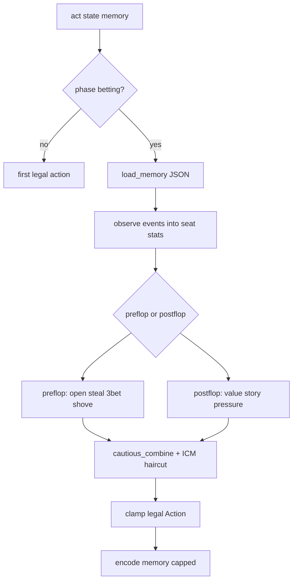

# Vedaant Seceret Strategies HeHeHe

Design for the RubricPressure ICM zoo bot. **The bot is implemented** in `zoo/codex_rubric_pressure_icm_1/agent.py`; results are under Strategy F in [`STRATEGIES.md`](STRATEGIES.md). The sections below are the original handoff plan, kept as the design record.

## Status on this branch

- Branch: `zoo/rubric-pressure-icm` (stacked on `zoo/strategy-opponents` / PR #1)
- Bot: `zoo/codex_rubric_pressure_icm_1/agent.py` — implemented from the design below (was a copy of `zoo/_template`)
- This document: full design + transfer map + validation checklist

## Decisions locked

- **Label / PR title:** `Vedaant Seceret Strategies HeHeHe`
- **Kind:** Strong zoo bot (not a `starter/` competitive copy)
- **Ship path:** PR into `zoo/strategy-opponents` so it stacks on PR #1
- **Name / folder:** `zoo/codex_rubric_pressure_icm_1/`
- **Size target:** Mid-weight (~300–450 LOC, ~15–25 KB) like `codex_steal_value_1`, not the ~45 KB D/E equity-grid bots
- **Hard constraints:** one standalone `agent.py`, stdlib only (+ eval7 ok), 1 ms/decision, state only in memory bytes (cap ~4 KB JSON like steal_value), no imports from `starter/` or other zoo bots

## Gap this bot fills

Existing PR #1 bots (`codex_steal_value_1`, `codex_adaptive_icm_1`, and siblings) steal and value-bet stations, but **do not bluff** and **rarely raise postflop without a strong made hand**. RubricPressure ICM’s job is scheduled steal + **semibluff / pressure raises** on flop/turn/river when fold equity is there, tempered by ICM.

## Transfer map (projects → bot)

| Source | Pattern | In `agent.py` |
| --- | --- | --- |
| lookout `rubric.py` | base rate + fixed bounded deltas + clip | `p = clip(PRIOR[spot] + STEP * Σ pts)` for raise/call |
| atlas `odds.py` | fixed priors until `n ≥ N_MIN`, then clamped fit | per-seat fold/call/raise counters; exploit only after ≥10–24 samples |
| atlas `money_review.combine` | disagree → conservative | if hand-strength and pressure-story disagree under high ICM → check/call, not big bluff |
| tide / horizon | placebo + neighbourhood + holdout | **offline** validation only |

Nothing from lookout/atlas/nbapred/QuantLab transfers as live Kelly, Monte Carlo, or Bayesian models under the 1 ms / stdlib / 64 KB rules.

## Bot design

**Thesis:** Every spot starts from a frozen prior (lookout-style). Feature points adjust for position, pot odds, board texture, draw outs, and villain fold tendency from memory. Strength-line and pressure-line are computed separately; under bubble/ICM pressure they combine cautiously (atlas). After enough samples, clamped EWMA offsets widen steals and enable small bluff raises against overfolders — without needing the nuts.

**Concrete behaviors**

1. **Preflop:** Positional opens (≈2–2.5× BB), wider steals when estimated fold rate is high (steal_value pattern), ICM-tightened open/call thresholds when short stacks / bubble (adaptive_icm pattern), shove/fold under ~12–15 BB with payout-aware call margin.
2. **Postflop value:** Bet/raise strong made hands; size up vs stations (call-heavy seats).
3. **Postflop pressure (the niche):** On dry/paired boards and vs foldy seats, fire small c-bets and **turn/river probe raises** when `p_story` clears clip and ICM is not in cautious mode — even without top pair (semibluff with draws; pure thin pressure at low frequency).
4. **Memory:** Compact JSON like steal_value (`seat → [seen, folds, calls, raises]` + optional fold-to-agg counters), capped to `min(4096, state.config.memory_bytes)`, reset on overflow. No state on `self`.
5. **Safety:** `legal()` clamp; non-betting phases → first legal; try/except → check/fold; header docstring with Source / Profile / Notes.

## Finish checklist

Steps 1–3 are done. Not done: the neighbourhood smoke test on the bluff threshold, and any run on the organizers' kit.

1. Implement full standalone `zoo/codex_rubric_pressure_icm_1/agent.py` (reimplement ideas from steal_value + adaptive ICM; do not import them).
2. Append Strategy F to `zoo/STRATEGIES.md` (label: Vedaant Seceret Strategies HeHeHe).
3. Validate:
   - `python3.12 tools/check_zoo.py zoo/codex_rubric_pressure_icm_1`
   - `python3.12 devtest/mini_sim.py check zoo/codex_rubric_pressure_icm_1/agent.py`
   - 60–200 matched tables vs zoo + sparring; neighbourhood smoke on bluff threshold
4. Push updates on this branch / update the PR.

## Out of scope for the bot itself

- Merging or rewriting PR #1’s five bots
- Putting this bot in `starter/` / `v2/` as the competition entry
- Regenerating D/E equity grids
- Full 1000-tournament placebo CI (too heavy for zoo ship)
